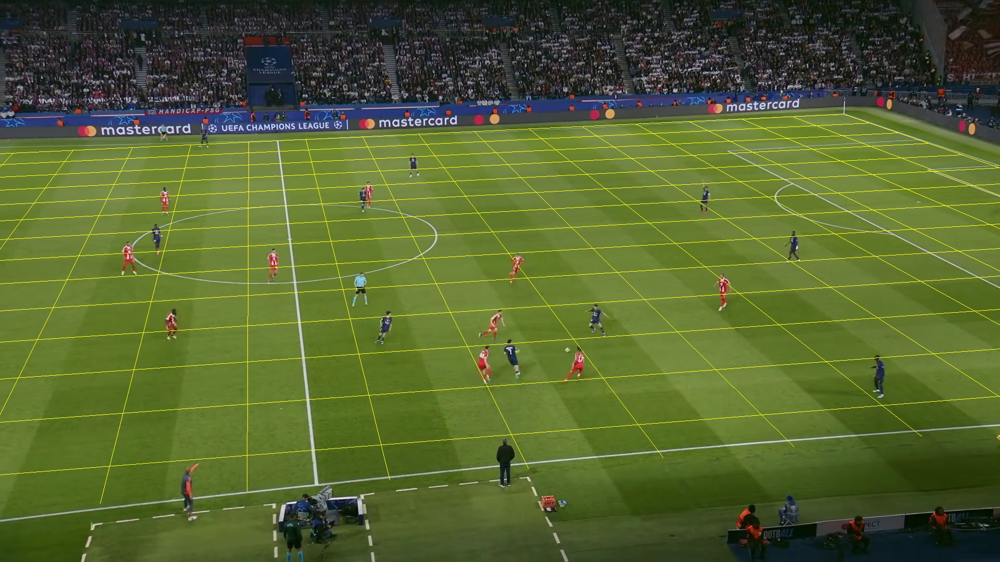
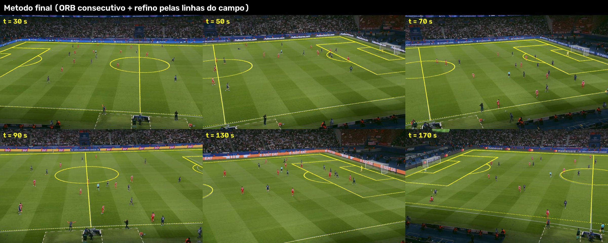
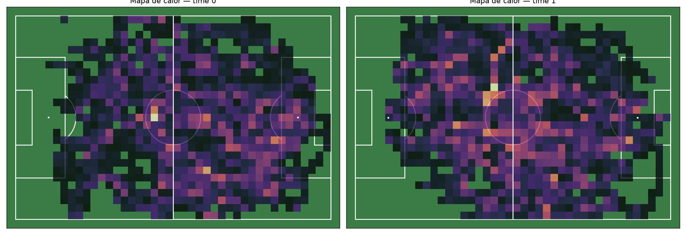
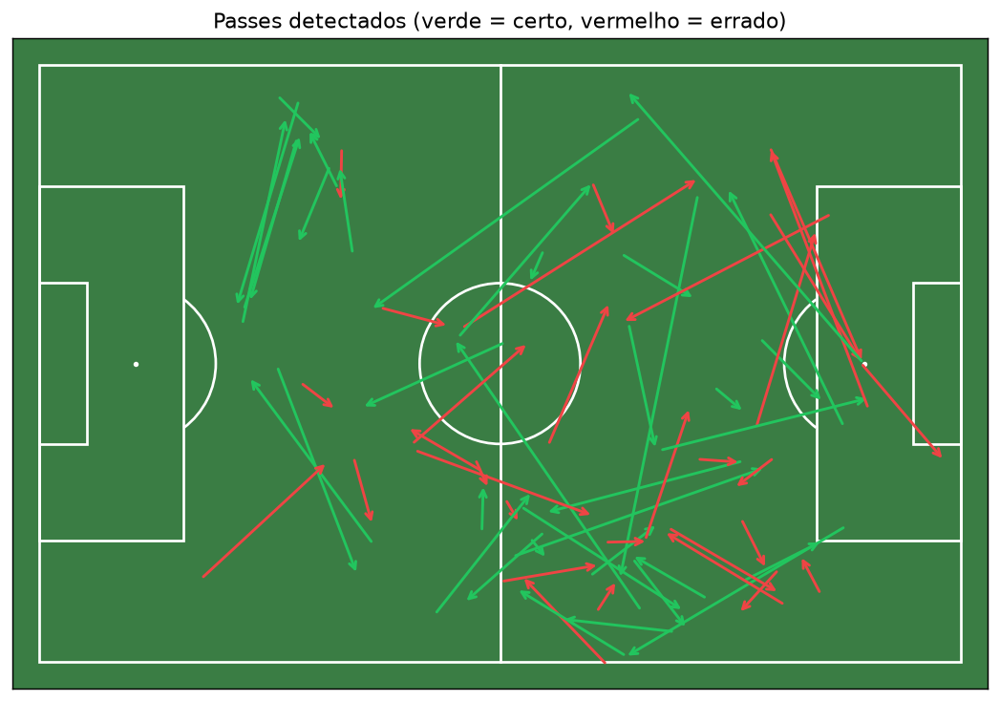
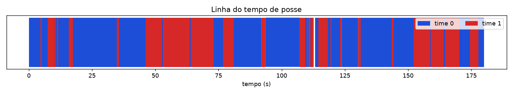
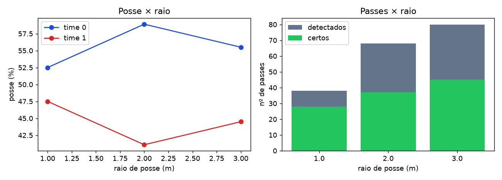
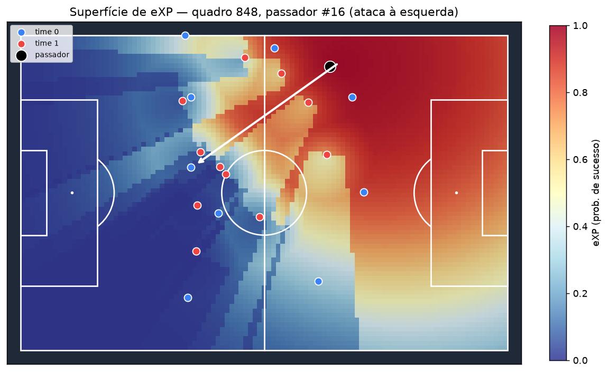
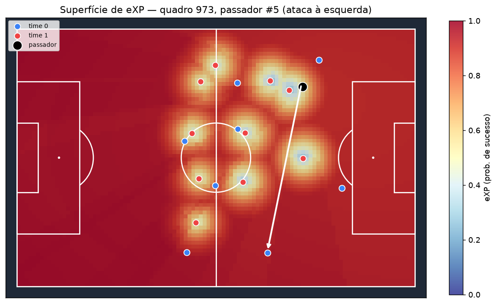
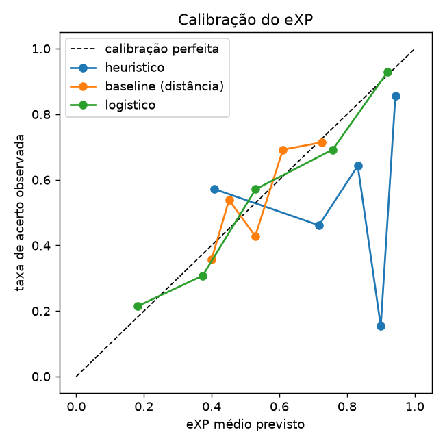

# Prática 3 — Futebol Analytics com YOLO · PSG × Bayern

**Visão Computacional · CESAR School · 2026.2** — detecção, rastreamento, projeção no campo e métricas de jogo (posse, passes, eXP) a partir de um trecho de transmissão.

**Grupo:** Helder Cordeiro de Barros Filho · Lucas Rafael Gomes Maia da Silva · José Kevin Sales da Silva · Lucas Jerônimo Mendes · Felipe Salustiano Moreira
**Apresentação (09/11/2026):** Lucas Rafael

> **Sobre os números deste README:** todas as tabelas entre marcadores `<!-- AUTO:... -->` são geradas por `gerar_readme_numeros.py` a partir dos arquivos em `saidas/psg_bayern/`. Nenhuma métrica foi digitada à mão; `python gerar_readme_numeros.py --saida saidas/psg_bayern --verificar` confere a consistência README × arquivos.

---

## 1. Vídeo (fora do repositório)

| Item | Valor |
|---|---|
| Jogo | Paris Saint-Germain × Bayern de Munique — câmera tática |
| URL | https://www.youtube.com/watch?v=fg3DmFxMWZ4 |
| Intervalo usado | **18:20 – 21:20** (3 min) |
| Arquivo local | `videos/Psg Bayern - camara tactica_clip.mp4` (ignorado pelo git) |
| Onde obter | Google Drive do grupo: `https://drive.google.com/drive/u/1/folders/1kH0DHNEouE_V021al4N0HwpulaLJAXrD` |

O vídeo foi baixado e cortado fora do pipeline (não é versionado). Propriedades medidas por `extrair_frame0.py`:

<!-- AUTO:video -->
| Resolução | FPS | Quadros | Duração | Cortes de câmera detectados |
|---|---:|---:|---:|---|
| 1920×1080 | 25 | 4500 | 180.0 s | nenhum |
<!-- /AUTO:video -->

## 2. Pipeline

```
vídeo (3 min, 1080p25)
  │  extrair_frame0.py ─────────────► frame0.jpg, video_info.json (validação + cortes de cena)
  │  comparar_yolo.py ──────────────► comparar_yolo.csv  (n/s/m × imgsz × conf da bola, 30 s)
  ▼
detectar_rastrear.py  (YOLO COCO pessoa+bola · ByteTrack · filtro de gramado · K-Means de cor)
  │                   ─────────────► tracks.csv, meta.json, rastreado.mp4 (fora do git)
  ├─ bola_kalman.py  (Kalman + gating) ──────────────► bola.csv, bola_resumo.json
  └─ ferramentas/clicar_marcos.py (H0) + ferramentas/calibrar_ancoras.py (10 âncoras)
     homografia.py pares (ORB consecutivo) · refinar (ICP ponto-à-reta nas linhas) · projetar
                                     ──────────────► calibracao*.json, camera_refinada.npy,
                                                     tracks_campo.csv, bola_campo.csv
  ▼
metricas.py  (posse < 2 m, distância/velocidade, passes, mapas) ──► metricas_times.json,
  │                                                                 metricas_jogadores.csv, passes.csv
  ├─ sensibilidade_posse.py (raio 1/2/3 m) ─────────► sensibilidade_raio.csv
  ├─ ferramentas/anotar_passes.py + validar_passes.py ► passes_anotados.csv, validacao_passes.json
  └─ xpass.py  (baseline · heurístico · logístico · superfície · what-if · PAx) ► resultados_xp.csv
  ▼
gerar_readme_numeros.py (tabelas do README) · gerar_clipe.py (clipe da apresentação) · slides/
```

Ponto de projeção: **pé do jogador** (centro da base do bbox); a posição no campo é `[x, y, 1]ᵀ ~ Hₜ · [u, v, 1]ᵀ`, com `Hₜ = refino_linhas(Hₜ₋₁ · Mₜ)` (Mₜ = homografia ORB do quadro t para o t−1) e `H₀` da calibração manual, em metros, campo 105 × 68 m (origem no canto superior esquerdo visto da câmera).

## 3. Como rodar (Windows / PowerShell)

```powershell
python -m venv .venv; .\.venv\Scripts\Activate.ps1
pip install torch==2.11.0 torchvision==0.26.0 --index-url https://download.pytorch.org/whl/cu128
pip install -r requirements.txt
python -c "import torch; print(torch.cuda.is_available(), torch.cuda.get_device_name(0))"

$V = "videos/Psg Bayern - camara tactica_clip.mp4"; $S = "saidas/psg_bayern"

# Etapa 1 — validação do vídeo
python extrair_frame0.py --video $V --saida $S --cortes
# Etapa 2 — comparação de modelos e detecção/rastreamento
python comparar_yolo.py --video $V --saida $S --modelos yolov8n.pt yolov8s.pt yolov8m.pt yolo11m.pt yolo11l.pt --imgsz 640 1280
python detectar_rastrear.py --video $V --saida $S --modelo yolov8m.pt --imgsz 1280 --k 3
# Etapa 3 — bola e homografia (clicar marcos abre uma janela)
python classificador_times.py --video $V --saida $S          # times por track (pós-processamento)
python ferramentas/clicar_marcos.py --saida $S                 # H0 no frame0 (janela)
python ferramentas/calibrar_ancoras.py --video $V --saida $S   # âncoras a cada 20 s (janela)
python homografia.py camera --saida $S --mascara gramado       # método do código de apoio (só comparação)
python homografia.py pares --saida $S                          # ORB entre quadros consecutivos
python homografia.py refinar --saida $S                        # validação independente nas âncoras
Copy-Item $S/camera_validacao_ancoras.csv $S/camera_validacao_independente.csv
python homografia.py refinar --saida $S --usar-ancoras         # versão final
python bola_kalman.py --saida $S
python homografia.py projetar --saida $S
# Etapa 4 — métricas, sensibilidade e validação
python metricas.py --saida $S
python sensibilidade_posse.py --saida $S --raios 1 2 3
python ferramentas/anotar_passes.py --video $V --saida $S      # anotação manual
python validar_passes.py --saida $S --tolerancia 1.0
# Etapa 5 — eXP
python xpass.py --saida $S --what-if
# README, clipe e slides
python gerar_readme_numeros.py --saida $S
python gerar_readme_numeros.py --saida $S --verificar
python gerar_clipe.py --video $V --saida $S --inicio-s 0 --fim-s 90
python slides/gerar_slides.py --saida $S
```

Parâmetros finais usados: `yolov8m.pt`, `--imgsz 1280`, `--conf 0.10` (pessoas, limiares de track no `bytetrack_futebol.yaml`), `--conf-bola 0.10`; times por `classificador_times.py` (k = 2 entre tracks + regra do árbitro); bola com `--max-lacuna 15 --gate 6` e filtro de campo (folga de 1 m); `metricas.py` com raio de posse 2 m (padrão do enunciado), deslocamento mínimo do passe 3 m, duração máxima 4 s e direção de ataque estimada (PSG → esquerda, conferida pelas extremidades das linhas de cada time); validação com tolerância de 1 s.

---

## 4. Parte 1 — Aquisição

**Q1.1 — Escolha do jogo e do trecho.**
Escolhemos PSG × Bayern (Champions League) numa **câmera tática**: plano alto e aberto, que mostra quase toda a largura do campo, sem replays nem cortes (o detector de cortes por histograma não encontrou nenhum em 180 s) e sem placar sobreposto à imagem. Os uniformes contrastam bem — PSG azul-marinho, Bayern vermelho — e a iluminação noturna é artificial e uniforme. Pontos que atrapalham: (i) a câmera faz **pan de um gol ao outro, com zoom** (o centro da imagem se desloca até ~2.000 px em relação ao quadro 0), o que exigiu compensação de movimento; (ii) por ser alta e aberta, os jogadores são pequenos (~61 px de altura) e a bola menor ainda (~13 px); (iii) há sombras no gramado e a comissão técnica/gandulas aparecem no gramado junto à lateral.

**Q1.2 — Resolução, fps, nº de quadros e custo.** Ver a tabela da Seção 1 e o fps de processamento na Seção 5.
1920 × 1080, 25 fps, 4.500 quadros (180 s). No nosso hardware (RTX 5060 Ti 8 GB, PyTorch CUDA 12.8), a detecção + rastreamento com `yolov8m` a 1280 px e a predição extra da bola rodou a **13,2 fps** gravando o vídeo anotado (~5,7 min para o trecho); sem gravar vídeo, a comparação de modelos mediu 19,6 fps. As outras etapas são de CPU: classificação de times por track (~3 min), homografias entre quadros consecutivos (~5 min) e refino pelas linhas (~5 min). O pipeline inteiro roda em ~20 min — viável para trechos curtos, mas não em tempo real.

## 5. Parte 2 — Detecção (YOLO COCO)

Comparação no mesmo subtrecho de 30 s (`comparar_yolo.py`). Pessoas via `track()` (ByteTrack); bola via `predict()` separado com conf baixo, como no pipeline final:

<!-- AUTO:yolo -->
Subtrecho: **0-30s** do clipe (750 quadros).

| modelo | imgsz | fps | pessoas/quadro | IDs únicos | % bola (conf≥0,05) | % bola (conf≥0,10) | % bola (conf≥0,25) | % bola só via track |
|---|---:|---:|---:|---:|---:|---:|---:|---:|
| yolov8n.pt | 640 | 32.8 | 18.41 | 211 | 8.7 | 3.5 | 0.3 | 0 |
| yolov8n.pt | 1280 | 30.4 | 26.3 | 221 | 79.1 | 57.1 | 27.6 | 2.3 |
| yolov8s.pt | 640 | 30.4 | 20.3 | 150 | 13.2 | 5.5 | 0.3 | 0 |
| yolov8s.pt | 1280 | 26.9 | 27.47 | 198 | 58.9 | 38.9 | 14.3 | 0.3 |
| yolov8m.pt | 640 | 27.3 | 22.48 | 124 | 29.5 | 12.7 | 1.6 | 0 |
| yolov8m.pt | 1280 | 19.6 | 27.58 | 127 | 76.7 | 59.5 | 31.2 | 4.1 |
| yolo11m.pt | 640 | 24.3 | 18.83 | 127 | 12.5 | 5.1 | 2.4 | 0 |
| yolo11m.pt | 1280 | 18.9 | 25.91 | 107 | 60.7 | 42.8 | 17.9 | 0.9 |
| yolo11l.pt | 640 | 15.9 | 20.4 | 101 | 16.5 | 6.9 | 1.6 | 0 |
| yolo11l.pt | 1280 | 15.3 | 25.76 | 98 | 60.4 | 42.8 | 23.3 | 1.7 |
<!-- /AUTO:yolo -->

Quadros anotados de cada combinação (falsos positivos de bola visíveis): `figuras/comparar_yolo/`.

**Q2.1 — Comparação e escolha do modelo.**
No mesmo subtrecho de 30 s (tabela `comparar_yolo.csv`), a resolução pesou mais que o tamanho do modelo: a 640 px nenhum modelo passou de 13% dos quadros com bola (conf ≥ 0,10). A 1280 px, o **`yolov8m`** teve o melhor equilíbrio: 59,5% dos quadros com bola (conf ≥ 0,10) e 31,2% com conf ≥ 0,25 (o maior entre todos), 27,6 pessoas/quadro e **127 IDs únicos** — contra 221 do `yolov8n`, o que indica menos fragmentação de tracks. Os `yolo11m/l` não superaram o `yolov8m` na bola e foram mais lentos. Custo: 19,6 fps, suficiente para o trecho. Por isso escolhemos `yolov8m` @ 1280.

**Q2.2 — Por que a bola é mais difícil?**
Na câmera tática a bola mede ~13 × 12 px, contra ~61 px de altura de um jogador; a 640 px de entrada ela vira 4–5 px, abaixo do que o detector resolve. Ela também sofre borrão de movimento nos passes, fica oculta por pernas e corpos e se confunde com objetos brancos pequenos (cabeças, garrafas, letras das placas). Isso é o mesmo fenômeno de Ahmad Yousef et al. (2025, Tabela 2): F1 da bola ~0,31 sem filtro de Kalman, contra > 0,9 para jogadores. Um detalhe do nosso caso: o ByteTrack praticamente descarta a bola — só **4,1%** dos quadros tiveram bola vinda do `track()` (detecções de baixa confiança não viram track); por isso a bola é detectada por um `predict()` separado com confiança baixa.

**Q2.3 — Efeito de imgsz e conf da bola.**
Dobrar a resolução de 640 para 1280 px multiplicou a detecção da bola (yolov8m: 12,7% → 59,5% dos quadros com conf ≥ 0,10), ao custo de ~30% de velocidade. Baixar o limiar de 0,25 para 0,05 aumenta a cobertura (31% → 77%), mas traz falsos positivos: no trecho inteiro, **2.744 das 4.363 candidatas (63%)** foram projetadas **fora do campo** — placas de publicidade, torcida e as garrafas de água da área técnica. Por isso usamos conf 0,10 e deixamos o filtro de campo + o gating do Kalman escolherem a candidata coerente. Exemplos visuais: `figuras/comparar_yolo/`.

## 6. Parte 3 — Rastreamento e times

<!-- AUTO:deteccao -->
| Item | Valor |
|---|---|
| Modelo / imgsz | yolov8m.pt / 1280 |
| Device | cuda |
| Rastreador | bytetrack_futebol.yaml |
| Quadros processados | 4500 |
| Velocidade de processamento | 13.2 fps |
| Pessoas por quadro (média) | 24.6 |
| IDs únicos de pessoa | 365 |
| IDs por time (0 / 1 / outros) | 128 / 73 / 36 |
| Cor do cluster -2 (BGR) — arbitragem/goleiros/outros | (82, 113, 92) |
| Cor do cluster 0 (BGR) — PSG | (70, 98, 88) |
| Cor do cluster 1 (BGR) — Bayern | (74, 111, 138) |
<!-- /AUTO:deteccao -->

Ajustes do grupo em relação ao código de apoio: (i) `bytetrack_futebol.yaml` com `track_buffer` de 3 s e limiar de novo track mais alto; (ii) descarte de "pessoas" cujos pés não estão sobre a grama (torcida/placas); (iii) **times por track** (`classificador_times.py`, pós-processamento): o classificador online fixava o time com ~10 recortes e errava jogadores distantes; agora um descritor de cor (frações de vermelho, azul, branco, escuro…) é calculado em todos os recortes de cada track e agrupado por K-Means k = 2 entre tracks; (iv) **regra do árbitro**: com k = 3 o 3º cluster virou o técnico de preto e com k = 4 jogadores do PSG bem iluminados; o uniforme da arbitragem é o único com fração de ciano relevante (ver `times_por_track.csv`); (v) descarte, nas métricas, de tracks cuja posição mediana está fora do campo (comissão técnica, gandulas); (vi) descarte de candidatas a bola projetadas fora do campo antes do Kalman (placas, torcida, garrafas da área técnica).

**Q3.1 — Trocas de ID.**
Há ~24,6 pessoas visíveis por quadro, mas o ByteTrack gerou **365 IDs** em 3 min; a duração mediana de um ID é de só 2 s, 146 IDs duram menos de 1 s e apenas 14 IDs duram ≥ 60 s. Contando tracks que **nascem longe da borda da imagem** (logo, não são jogadores entrando no quadro), são ~83 novos IDs por minuto — um limite superior para as trocas. As situações típicas: disputas e aglomerações (um jogador oculto por outro), jogadores pequenos no lado oposto da câmera (detecção intermitente) e o pan da câmera (jogadores saem e voltam ao quadro com ID novo).

**Q3.2 — K-Means de cor funcionou?**
O classificador online do código de apoio funcionou parcialmente: ao assistir o vídeo, jogadores distantes do Bayern apareciam como PSG e o árbitro caía no time do PSG, porque o time de cada ID era fixado com ~10 recortes ruidosos. Refizemos a classificação **por track**: um descritor de cor (frações de vermelho, laranja, azul, branco, escuro…) é calculado em todos os recortes de cada ID e agrupado com K-Means k = 2 entre tracks. Os centróides ficaram nítidos: PSG = 23% azul + 32% escuro; Bayern = 45% vermelho + 43% laranja. Sobre o espaço (S·cos H, S·sin H, V): o matiz é um **ângulo** e o vermelho fica nas duas pontas da escala do OpenCV (H ≈ 0 e H ≈ 179). A média simples de pixels vermelhos daria H ≈ 90 — **ciano** —, justamente a cor errada para o Bayern. Tratando H como ângulo (cos/sin ponderados pela saturação), o vermelho vira um único ponto.

**Q3.3 — k = 3.**
Não resolveu sozinho. No classificador online, o 3º cluster virou "pixels escuros/sombra" (centróide BGR ≈ (19, 36, 20)), não o árbitro. Na classificação por track, k = 3 separou o **técnico de preto** e k = 4 separou **jogadores do PSG bem iluminados** — ou seja, o cluster extra captura a maior variação de cor que existir, não necessariamente o árbitro. A solução foi uma regra explícita: o uniforme da arbitragem é o único com fração relevante de ciano (≥ 0,09; PSG ≤ 0,01), o que separou árbitro e assistentes (36 tracks em "outros"). Risco: a regra é específica deste jogo/uniforme e precisa ser revista em outro vídeo.

## 7. Parte 4 — Bola e homografia

**Bola (filtro de Kalman com gating):**

<!-- AUTO:bola -->
| Quadros | Com detecção YOLO | Candidatas (fora do campo) | Quadros com bola no campo | Aceitos após gating | Preenchidos pelo Kalman | Cobertura final |
|---:|---:|---:|---:|---:|---:|---:|
| 4500 | 2794 (62.1%) | 4363 (2744) | 1450 | 1077 | 2355 | 76.3% |
<!-- /AUTO:bola -->

**Calibração (marcos clicados no frame0) e câmera:**

<!-- AUTO:calibracao -->
| marco | pixel (u, v) | erro de reprojeção (m) |
|---|---|---:|
| meio_sup | (533, 270) | 0.10 |
| circulo_sup | (550, 395) | 0.09 |
| centro | (557, 458) | 0.16 |
| circulo_inf | (568, 544) | 0.17 |
| meio_inf | (607, 932) | 0.12 |
| canto_sup_dir | (1619, 220) | 0.09 |
| ga_dir_sup | (1400, 290) | 0.32 |
| pa_dir_sup | (1786, 328) | 0.23 |

Erro médio **0.16 m**, máximo **0.32 m** (8 marcos no frame0).
<!-- /AUTO:calibracao -->



**Compensação do movimento da câmera.** O método do código de apoio (ORB + RANSAC só no gramado, casando com quadros-chave) **derivou dezenas de metros** neste vídeo: a câmera tática faz pan de um gol ao outro, com zoom (`figuras/camera_deriva_metodo_apoio.jpg`). Testamos variantes no intervalo 0–20 s contra uma âncora manual (ORB ou SIFT; máscara de gramado, imagem toda ou sem arquibancada): todas acumularam 2,5–4 m de erro médio em 20 s. A solução adotada combina (i) homografias entre quadros **consecutivos** com ORB na imagem toda menos jogadores (uma câmera que só gira gera uma homografia para a cena inteira, inclusive a arquibancada, que tem mais textura que a grama) e (ii) um **refino por quadro pelas linhas do campo**: o modelo do campo é projetado e ajustado aos pixels de linha branca (distância ponto-à-reta, mínimos quadrados regularizados — direções que as linhas visíveis não determinam ficam como o ORB previu). As 10 âncoras clicadas à mão servem de validação:

<!-- AUTO:camera -->
Câmera: 4500 quadros, 0 cortes detectados; o pan desloca o centro da imagem até 2025 px em relação ao quadro 0.

**Âncoras manuais** (`ferramentas/calibrar_ancoras.py`):

| quadro | t (s) | marcos clicados | erro reproj. médio (m) |
|---:|---:|---:|---:|
| 0 | 0 | 8 | 0.16 |
| 500 | 20 | 7 | 0.08 |
| 1000 | 40 | 11 | 0.19 |
| 1500 | 60 | 12 | 0.11 |
| 2000 | 80 | 7 | 0.21 |
| 2500 | 100 | 17 | 0.20 |
| 3000 | 120 | 13 | 0.21 |
| 3500 | 140 | 16 | 0.24 |
| 4000 | 160 | 10 | 0.25 |
| 4499 | 180 | 16 | 0.35 |

**Validação independente** do método final (pares ORB consecutivos + refino pelas linhas do campo), inicializado **só** no quadro 0: erro da grade de 5 × 4 m visível em cada âncora manual, que NÃO entrou no cálculo:

| quadro | t (s) | pontos da grade | erro médio (m) | erro mediano (m) | erro máx (m) | âncora usada no cálculo? |
|---:|---:|---:|---:|---:|---:|---:|
| 0 | 0 | 224 | 0.27 | 0.25 | 0.6 | True |
| 500 | 20 | 207 | 1.27 | 1.01 | 4.83 | False |
| 1000 | 40 | 204 | 0.31 | 0.21 | 1.49 | False |
| 1500 | 60 | 191 | 0.85 | 0.6 | 3.23 | False |
| 2000 | 80 | 213 | 0.59 | 0.52 | 1.6 | False |
| 2500 | 100 | 218 | 0.14 | 0.09 | 0.5 | False |
| 3000 | 120 | 175 | 0.19 | 0.18 | 0.46 | False |
| 3500 | 140 | 268 | 2.24 | 1.23 | 12.28 | False |
| 4000 | 160 | 175 | 0.38 | 0.32 | 1.36 | False |
| 4499 | 180 | 202 | 0.2 | 0.18 | 0.58 | False |

Na versão final as âncoras também reiniciam a estimativa; 100.0% dos quadros foram refinados pelas linhas (mediana de 440 pontos de linha por quadro).
<!-- /AUTO:camera -->



**Q4.1 — Cobertura da bola antes/depois do Kalman.**
O YOLO teve candidatas em 62,1% dos quadros, mas só 32,2% tinham candidata **dentro do campo**. Depois do gating (que rejeitou detecções incoerentes com a trajetória em 373 quadros), o Kalman aceitou 1.077 quadros e **preencheu 2.355** por predição, chegando a **76,3% de cobertura**. Onde ele acerta: lacunas curtas (≤ 15 quadros = 0,6 s) em passes rasteiros, em que a bola segue quase em linha reta. Onde ele "inventa": antes do filtro de campo, o Kalman chegou a travar numa detecção falsa nas placas de publicidade e manter uma "bola" parada fora do campo; e em desvios/rebotes ele continua a reta por até 0,6 s. Note que mais da metade da trajetória final vem de predição, não de detecção.

**Q4.2 — Erro de reprojeção por marco.**
No frame0 os 8 marcos tiveram erro de 0,09 a 0,32 m (média 0,16 m), melhor que o exemplo da disciplina (≤ 0,41 m). Os maiores erros foram nas **quinas das áreas do lado direito** (`ga_dir_sup` 0,32 m, `pa_dir_sup` 0,23 m), os pontos mais distantes da câmera: lá 1 pixel equivale a muito mais metros, então um erro de clique de 1–2 px vira dezenas de centímetros. Os marcos da linha do meio, perto da câmera e bem definidos, ficaram em ~0,1 m.

**Q4.3 — Composição H0 · Gₜ e deriva.**
H0 leva pixels do quadro 0 ao campo; Gₜ leva pixels do quadro t ao quadro 0 (estimada por ORB + RANSAC). Compor H0 · Gₜ projeta o quadro t no campo — mas Gₜ é um **produto** de muitas estimativas, e cada uma tem um pequeno erro que se acumula (**deriva**). Neste vídeo, o método do código de apoio (ORB só no gramado, com quadros-chave) derivou dezenas de metros em 60 s (`figuras/camera_deriva_metodo_apoio.jpg`); testamos ORB e SIFT com várias máscaras e todos acumularam 2,5–4 m de erro médio em só 20 s. Para **re-ancorar**: (i) a cada quadro, ajustamos a homografia às **linhas do campo** detectadas (distância ponto-à-reta, mínimos quadrados regularizados), o que impede o erro de se acumular; (ii) clicamos 10 quadros-âncora (a cada 20 s). Validação independente (inicializando só no quadro 0): erro médio de 0,14 a 1,27 m nas âncoras, com pior caso de 2,24 m aos 140 s. Na versão final as âncoras também reiniciam a estimativa.

**Q4.4 — Por que o pé do jogador? E a bola no ar?**
A homografia só vale para pontos **no plano do gramado**. O pé do jogador (centro da base do bbox) está no chão; o centro do bbox está ~1 m acima, e projetá-lo como se estivesse no chão o empurra para longe da câmera — alguns metros de erro nesta câmera alta. A bola no ar viola a mesma hipótese: num lançamento ela aparece mais "alta" na imagem e é projetada **mais longe da câmera** do que está, distorcendo distância e destino do passe. Nossos passes são majoritariamente rasteiros, mas lançamentos longos têm a posição projetada errada (e podem ser descartados pelo filtro de campo).

## 8. Parte 5 — Métricas de jogo

<!-- AUTO:metricas -->
Raio de posse: **2.0 m** · quadros com bola: 3315/4500 · direção de ataque: time 0 → esquerda, time 1 → direita

| time | posse (%) | passes | passes certos | precisão (%) | distância total (m) |
|---|---:|---:|---:|---:|---:|
| 0 (PSG) | 58.9 | 40 | 24 | 60 | 4418 |
| 1 (Bayern) | 41.1 | 28 | 13 | 46.4 | 5057 |
<!-- /AUTO:metricas -->

<!-- AUTO:jogadores -->
Jogadores rastreados por ≥ 60 s (top 8 em distância):

| track_id | time | tempo_s | distancia | vel_media | vel_max_kmh | m_por_min |
|---:|---:|---:|---:|---:|---:|---:|
| 447 | 0 | 130 | 363 | 2.80 | 26.4 | 167 |
| 13 | 1 | 147 | 361 | 2.46 | 31.7 | 147 |
| 114 | 1 | 142 | 358 | 2.53 | 30.2 | 151 |
| 610 | 1 | 119 | 336 | 2.85 | 19.9 | 170 |
| 288 | 1 | 112 | 307 | 2.74 | 30.3 | 164 |
| 370 | 0 | 106 | 281 | 2.68 | 31.5 | 159 |
| 630 | 0 | 117 | 243 | 2.09 | 21.0 | 125 |
| 412 | 1 | 80 | 233 | 2.93 | 21.7 | 175 |
<!-- /AUTO:jogadores -->





**Sensibilidade ao raio de posse:**

<!-- AUTO:sensibilidade -->
| raio_m | quadros_com_dono_pct | posse_time0_pct | posse_time1_pct | passes | passes_certos | precisao_passe_pct | validacao_precisao | validacao_revocacao | validacao_f1 |
|---:|---:|---:|---:|---:|---:|---:|---:|---:|---:|
| 1 | 25.4 | 52.5 | 47.5 | 38 | 28 | 73.7 | 0.55 | 0.46 | 0.5 |
| 2 | 54.8 | 58.9 | 41.1 | 68 | 37 | 54.4 | 0.37 | 0.54 | 0.44 |
| 3 | 69.2 | 55.5 | 44.5 | 80 | 45 | 56.2 | 0.29 | 0.5 | 0.37 |
<!-- /AUTO:sensibilidade -->



**Validação manual dos passes** (`passes_anotados.csv`, anotado pelo grupo assistindo ao vídeo original):

<!-- AUTO:validacao -->
| Detectados | Anotados | Casados (VP) | FP | FN | Precisão | Revocação | F1 | Acordo certo/errado |
|---:|---:|---:|---:|---:|---:|---:|---:|---:|
| 68 | 46 | 25 | 43 | 21 | 0.37 | 0.54 | 0.44 | 0.76 |

Tolerância temporal: ±1.0 s. Passes certos — anotados: 91.3%, detectados: 54.4%.
<!-- /AUTO:validacao -->

**Q5.1 — Posse, distância e velocidade são plausíveis?**
Posse: PSG 58,9% × Bayern 41,1% (raio 2 m). Nos 13 jogadores rastreados por ≥ 60 s, a distância por minuto teve mediana de **159 m/min** e máximo de 175 m/min — acima dos ~110–120 m/min médios de um jogo inteiro. Parte é real (3 min de jogo corrido são mais intensos que a média de 90 min), mas parte é **ruído**: o "tremor" do bbox e o erro da homografia somam deslocamentos falsos (a mediana móvel atenua, não elimina). A velocidade máxima (mediana 26,4 km/h, máximo 32,3 km/h) é plausível para sprints de elite (~33–36 km/h). A distância **por time** é subestimada, porque cada ID cobre só parte do trecho (trocas de ID, jogadores fora do quadro com o pan).

**Q5.2 — Sensibilidade ao raio.**
| raio | quadros com dono | posse PSG/Bayern | passes | % certos | F1 da validação |
|---|---|---|---|---|---|
| 1 m | 25% | 52,5 / 47,5 | 38 | 73,7% | 0,50 |
| 2 m | 55% | 58,9 / 41,1 | 68 | 54,4% | 0,44 |
| 3 m | 69% | 55,5 / 44,5 | 80 | 56,2% | 0,37 |

Raio maior "dá" a bola a mais jogadores, inclusive adversários que só passam perto dela: surgem mais passes e mais "passes errados" falsos, e o F1 cai. Com 1 m a precisão dos passes detectados sobe (0,55) e a % de certos fica mais realista, mas a revocação cai e só 25% dos quadros têm dono. A posse oscila ~6 pontos percentuais entre os raios — a métrica é sensível a um parâmetro arbitrário.

**Q5.3 — Validação: quais erros dominam?**
Contra 46 passes anotados à mão (tolerância de 1 s): **precisão 0,37, revocação 0,54, F1 0,44**; nos 25 casados, o rótulo certo/errado bate em 76%. Dominam os **falsos positivos (43)**: metade deles (23) são "passes errados" que na verdade são disputas, divididas ou a bola passando perto de um adversário — o detector registra uma "troca de dono" sem passe. Por isso ele marca só 54% dos passes como certos, contra **91%** na anotação. Os **falsos negativos (21)** são quase todos passes certos (19) e 14 deles do Bayern: passes curtos/rápidos em que a bola some (oclusão, lacuna maior que o Kalman cobre) ou em que receptor e passador estão a < 3 m. Há ainda 6 passes que casam no tempo mas com o **time errado** (posse atribuída ao time errado no instante do passe). Contradição relevante: a anotação mostra o **Bayern com mais passes** (27 × 19), enquanto a posse calculada favorece o PSG — o PSG tem mais IDs classificados (128 × 73, inclusive membros da comissão técnica de roupa escura), o que pode enviesar o "jogador mais próximo da bola" a favor dele.

**Q5.4 — Direção de ataque, trocas de ID e jogadores fora do quadro.**
A heurística estimou PSG → esquerda e conferimos pelos dados: o jogador mais avançado do PSG fica em média em x = 76 m (contra 70 m do Bayern) e o mais recuado do Bayern em 40,6 m (contra 43,3 m do PSG), ou seja, o PSG defende o gol da direita, onde também aparecem os goleiros detectados quando ele defende. Trocas de ID quebram a distância de um jogador em vários pedaços e criam "passes" falsos (o mesmo jogador com ID novo vira passador e receptor — o filtro de deslocamento ≥ 3 m atenua). Jogadores fora do quadro (pan) somem das métricas e da contagem de adversários na linha do passe. Correções propostas: re-identificação por aparência/número da camisa para juntar tracks do mesmo jogador; restrição física (um ID novo que aparece onde outro do mesmo time sumiu, < 1 s antes, é o mesmo jogador); e, idealmente, câmera fixa de campo inteiro ou dados de tracking.

## 9. Parte 6 — eXP (expected pass)

`eXP = σ(β0 + β1·distância + β2·adversários na linha + β3·pressão no passador + β4·espaço no destino + β5·progressão x + β6·distância ao gol)`

<!-- AUTO:xp -->
**A — rótulos da anotação manual** (passes detectados que casaram com `passes_anotados.csv`):

Base: **25 passes (92.0% certos, 2 errados)** · rótulos: anotação manual (passes detectados casados com passes_anotados.csv).

| modelo | AUC-ROC (↑) | Brier (↓) | Log-Loss (↓) | Avg Precision (↑) | média prevista | taxa observada |
|---|---:|---:|---:|---:|---:|---:|
| heuristico | 0.739 | 0.115 | 0.408 | 0.972 | 0.783 | 0.92 |

_Com tão poucos passes errados não há como ajustar baseline/logístico com validação cruzada; as métricas acima (só 2 negativos) não têm significância estatística._

**B — rótulos do próprio detector** (troca de dono; todos os passes detectados, validação cruzada estratificada):

Base: **68 passes (54.4% certos, 31 errados)** · rótulos: detector (troca de dono).

| modelo | AUC-ROC (↑) | Brier (↓) | Log-Loss (↓) | Avg Precision (↑) | média prevista | taxa observada |
|---|---:|---:|---:|---:|---:|---:|
| heuristico | 0.544 | 0.338 | 0.98 | 0.679 | 0.759 | 0.544 |
| baseline (distância) | 0.641 | 0.235 | 0.661 | 0.691 | 0.544 | 0.544 |
| logistico | 0.792 | 0.19 | 0.589 | 0.784 | 0.552 | 0.544 |

**Referência de literatura** (outra base, ~7 mil passes de teste — não comparável diretamente):

| modelo | AUC-ROC (↑) | Brier (↓) | Log-Loss (↓) |
|---|---:|---:|---:|
| SoccerMap · Gomes et al. (2026) | 0.622 | 0.138 | 0.444 |
| Baseline de distância · Gomes et al. (2026) | 0.588 | 0.141 | 0.456 |
<!-- /AUTO:xp -->

A linha SoccerMap é **só referência de literatura** (Gomes et al., 2026: 52 partidas, ~7 mil passes de teste, dados de rastreamento óptico): base e tamanho amostral são muito diferentes dos nossos poucos passes de 3 minutos, então a comparação direta não é válida.

<!-- AUTO:pax -->
Top 5 PAx (passes certos − ΣeXP):

| passador | time | passes | certos | eXP | PAx |
|---:|---:|---:|---:|---:|---:|
| 16 | 0 | 2 | 2 | 0.97 | 1.03 |
| 4 | 0 | 1 | 1 | 0.23 | 0.77 |
| 1621 | 1 | 2 | 2 | 1.54 | 0.46 |
| 1406 | 1 | 2 | 2 | 1.66 | 0.34 |
| 9 | 0 | 2 | 2 | 1.67 | 0.33 |

What-if (destino deslocado 3–6 m, 2 passes errados): ganho médio de eXP **0.236**; 1 passes com ganho > 0,10.
<!-- /AUTO:pax -->





> **Atenção (vazamento de rótulo na versão B):** com rótulos do detector, "passe errado" significa "quem tocou depois é adversário", e a feature `espaco_destino` mede justamente a distância do adversário mais próximo ao ponto onde a bola chegou. O logístico dá peso alto a ela e "lê parte da resposta" — a AUC da versão B está otimista. 

Discussão: vazamento de rótulo na versão B
Na versão B, identificamos um vazamento de rótulo: o rótulo “passe errado” significa que o próximo dono da bola é um adversário, e a feature espaco_destino mede justamente a distância do adversário mais próximo ao ponto onde a bola chegou, ou seja, uma informação muito próxima do próprio resultado que o modelo tenta prever. Isso fica evidente nos pesos da regressão logística (features padronizadas): 1,07 para espaco_destino e apenas 0,08 para a distância. O sinal positivo da distância também é pouco coerente, pois sugere que passes mais longos seriam mais seguros.
Por isso, a AUC de 0,79 (contra 0,64 do baseline) provavelmente está inflada. Além disso, 23 dos 43 falsos positivos foram marcados pelo detector como passes errados, possivelmente disputas de bola.
A versão A, baseada em rótulos manuais, não apresenta esse problema, mas possui apenas 2 passes errados em 25 observações, uma amostra pequena demais para conclusões confiáveis. Como próximos passos, seria necessário medir o espaço no destino antes do passe e ampliar as anotações manuais.

**Q6.1 — Features × 17 canais de Gomes et al.**
| nossa feature | canal(is) análogo(s) na Tabela 1 |
|---|---|
| `distancia` | 3 (distância à bola), 17 (distância ao início do evento) |
| `adversarios_na_linha` | 11 (defensores entre bola e célula) |
| `pressao_passador` | 2 (ocupação do time defensor), localmente no passador |
| `espaco_destino` | 2 (ocupação defensiva) no destino |
| `progressao_x` | 5–7 (ângulos bola–gol) |
| `dist_destino_gol` | 4 (distância ao gol) |

Não conseguimos extrair com confiança: as **velocidades** (canais 8–9 e 12–16) — a da bola vem do Kalman em pixels, ruidosa e distorcida quando a bola sai do chão, e a dos jogadores é afetada por trocas de ID e tremor do bbox; a **ocupação completa** (canais 1–2), porque com o pan só parte dos 22 jogadores aparece; e o **instante exato do passe**, que no artigo vem de dados de evento e aqui é inferido pela troca de dono.

**Q6.2 — Baseline × heurístico × logístico; confiança com poucos passes.**
Com **rótulos manuais** sobram 25 passes, só 2 errados: não há como treinar baseline/logístico com validação cruzada, e a AUC do heurístico (0,74) com 2 negativos não tem significância nenhuma (um passe a mais muda tudo). Com **rótulos do detector** (68 passes, 31 "errados"): heurístico AUC 0,54, baseline de distância 0,64, logístico **0,79** (Brier 0,19, Log-Loss 0,59). Mas o logístico está **otimista por vazamento de rótulo**: "errado" significa "quem tocou depois é adversário", e `espaco_destino` mede a distância do adversário mais próximo ao ponto onde a bola chegou — o modelo lê parte da resposta (é a feature de maior peso, 1,07, contra 0,08 da distância). Com algumas dezenas de passes, os intervalos de confiança dessas métricas são enormes; a comparação com o SoccerMap (AUC 0,622 em ~7 mil passes, rastreamento óptico) é só de referência. Para melhorar: juntar passes de outros trechos/grupos (`--extra`) e medir o espaço no destino **antes** do passe (no quadro de saída), não onde a bola chegou.

**Q6.3 — Calibração (média prevista × taxa observada).**
Com rótulos manuais, o heurístico prevê em média 0,78 contra 0,92 observado: **subestima** a chance de acerto (é conservador). Com rótulos do detector, o heurístico prevê 0,76 contra 0,54 observado — parece superestimar, mas é porque o rótulo do detector inventa passes errados; o logístico fica calibrado (0,55 × 0,54) por ter sido ajustado nesses mesmos rótulos. Ou seja, a calibração depende mais da qualidade dos rótulos que do modelo. No artigo, a média prevista (0,830) coincide com a observada (0,829).

**Q6.4 — A superfície de eXP faz sentido tático?**
Parcialmente. A superfície do heurístico é quente em espaços abertos e esfria perto dos adversários e atrás de linhas de marcação, como na Fig. 1 de Gomes et al. Já a do logístico com rótulos do detector é dominada por "buracos" frios em volta de cada adversário e quase não depende da distância (coeficiente 0,08) — passes de 40 m em espaço aberto aparecem tão seguros quanto passes curtos, o que é taticamente implausível: é o sintoma do vazamento de rótulo e da amostra pequena.

**Q6.5 — What-if e PAx: quem se destaca? Limitações de 3 min.**
No PAx, o ID #16 (PSG) aparece no topo (+1,03), mas com **2 passes** — e um "jogador" aqui é um ID do rastreador, que se fragmenta; não dá para atribuir isso a uma pessoa nem tirar conclusão. No what-if (destino deslocado 3–6 m nos 2 passes errados rotulados à mão), um passe ganharia +0,44 de eXP com o receptor ~6 m mais aberto, e o outro só +0,04. Limitações de 3 min: poucas dezenas de passes, 1–2 por jogador, só 2 erros reais, IDs que não correspondem a jogadores, e métricas sensíveis a parâmetros (raio de posse). Servem para demonstrar o método, não para avaliar jogadores — para isso seriam necessários jogos inteiros, re-identificação e rótulos manuais em escala.

---

## 10. Análise crítica

### Como essas métricas poderiam ser usadas em estatísticas reais de futebol
As métricas do pipeline se parecem com as estatísticas que clubes e emissoras já usam, mas são extraídas do vídeo de transmissão, sem equipamentos caros de rastreamento. Na tática, a posse e os mapas de calor mostram como cada time ocupa o campo. No aspecto físico, a distância percorrida e a velocidade máxima acompanham o desempenho dos atletas. Na avaliação de jogadores, o eXP e o PAx comparam os passes certos com o esperado, e o what-if simula como o posicionamento do receptor mudaria a chance de acerto. Isso seria útil principalmente no scouting e na análise de desempenho. Para resultados confiáveis, porém, ainda seria preciso testar jogos completos, melhorar a identificação dos jogadores e a homografia e ampliar a validação manual.

### Limitações
O rastreamento se fragmenta: o ByteTrack gerou 365 IDs em 3 min, com duração mediana de 2 s, então um “jogador” nas métricas é um ID, não uma pessoa. A bola mede cerca de 13 px, some em oclusões e quando sobe, e só aparece em 74% dos quadros. Como a câmera é única e faz pan, parte dos jogadores fica fora do quadro, e a homografia tem erro de até 2,2 m nas âncoras, o que infla a distância percorrida. A comissão técnica e os gandulas no gramado também são confundidos com jogadores. As métricas dependem de parâmetros: a posse do PSG varia de 52,5% a 58,9% conforme o raio. Por fim, a amostra é pequena (46 passes anotados, só 2 errados entre os casados), o detector de passes tem F1 de 0,44, e os rótulos da versão B do eXP vêm do próprio detector, com vazamento de rótulo.

### Comparação com os artigos
Yousef et al. (2025) mostram que a detecção da bola é um dos maiores desafios, com o F1 aumentando de 0,31 para 0,96 com o uso do filtro de Kalman. Nosso trabalho confirma essa dificuldade, mas utiliza o filtro de outra forma: para suavizar a trajetória e preencher falhas na detecção. Com isso, a cobertura passou de 62% para 76% dos quadros. Porém, como não houve anotação manual da posição da bola, não foi possível calcular um F1 comparável.
Na identificação da posse, utilizamos o mesmo princípio do artigo, considerando o jogador mais próximo da bola. Entretanto, nossa validação mostrou dificuldades em distinguir passes de disputas de bola, com F1 de 0,44.
Já Gomes et al. (2026) obtiveram AUC de 0,622 com o SoccerMap, contra 0,588 do baseline. Nossos resultados de eXP não permitem uma comparação direta, devido à pequena amostra e aos problemas nos rótulos. Assim, conseguimos reproduzir métodos dos dois artigos, mas ainda precisamos de uma validação maior para avaliar sua eficácia.

### Próximos passos
Para reduzir a fragmentação dos IDs, usaríamos um modelo de re-identificação por aparência, que reconhece o jogador quando ele volta ao quadro. Para a bola, treinaríamos o YOLO em um dataset específico de futebol, em vez do modelo COCO, e anotaríamos a posição dela em alguns quadros para medir um F1 comparável ao de Ahmad Yousef et al. Na posse e nos passes, exigiríamos que a bola percorresse uma distância mínima antes de contar um passe, para separá-lo de disputas. No eXP, mediríamos o espaço no destino no quadro de saída do passe, eliminando o vazamento de rótulo, e juntaríamos mais trechos com anotação manual até ter passes errados suficientes para treinar e validar os modelos.

---

## 11. Estrutura do repositório

| Caminho | Conteúdo |
|---|---|
| `extrair_frame0.py`, `comparar_yolo.py`, `detectar_rastrear.py`, `classificador_times.py`, `bola_kalman.py`, `campo.py`, `homografia.py`, `metricas.py`, `sensibilidade_posse.py`, `validar_passes.py`, `xpass.py`, `soccermap_mini.py` | pipeline |
| `ferramentas/clicar_marcos.py`, `ferramentas/anotar_passes.py` | ferramentas manuais (calibração e anotação) |
| `gerar_readme_numeros.py`, `gerar_clipe.py`, `slides/` | README, clipe e slides |
| `saidas/psg_bayern/` | CSV/JSON gerados (`tracks.csv`, `meta.json`, `bola.csv`, `calibracao.json`, `tracks_campo.csv`, `passes.csv`, `passes_anotados.csv`, `metricas_times.json`, `metricas_jogadores.csv`, `resultados_xp.csv`, …) |
| `figuras/` | figuras usadas neste README |
| `prompt_claude_code_p3_futebol_yolo.md` | prompt usado com a IA (ver Declaração de Uso de IA) |

## 12. Referências

- Ahmad Yousef, K. M. et al. *Real-Time Football Match Analysis: Leveraging YOLO for Enhanced Object Detection and Possession Tracking.* Procedia Computer Science 272, 38–45, 2025.
- Gomes, R. et al. *Modelagem de Passes no Futebol via Componentes do Expected Possession Value com Redes Totalmente Convolucionais.* REIC 24:1, 2026.
- Zhang, Y. et al. *ByteTrack: Multi-Object Tracking by Associating Every Detection Box.* ECCV 2022.
- Código de apoio da disciplina: github.com/eron93br/vc-20262-p3.

---

## Declaração de Uso de IA

Conforme a *Política de Uso — Assistentes de IA e LLMs* (Visão Computacional · CESAR School · 2026.2).

**Identificação da atividade**

| Campo | Valor |
|---|---|
| Disciplina | Visão Computacional — VC001 |
| Data | 09/11/2026 |
| Alunos(as) | Helder Cordeiro de Barros Filho · Lucas Rafael Gomes Maia da Silva · José Kevin Sales da Silva · Lucas Jerônimo Mendes · Felipe Salustiano Moreira |
| Matrículas | `<!-- ESCREVER -->` |
| Atividade | Prática 3 — Futebol Analytics com YOLO |

**Seção A — Uso de LLM / assistente de IA**

| Campo | Valor |
|---|---|
| Utilizou IA? | ☒ Sim ☐ Não |
| Modelo(s) usado(s) | Claude Opus 5.5 (`claude-opus-5-5`), via Claude Code (extensão do VS Code) |
| Prompt(s) utilizado(s) | Prompt principal: [`prompt_claude_code_p3_futebol_yolo.md`](prompt_claude_code_p3_futebol_yolo.md) (texto exato enviado ao modelo, junto com os PDFs do enunciado e dos dois artigos). Prompts complementares enviados na mesma sessão (texto exato): (1) antes do prompt principal, para obter o trecho: "quero utilizar o script do arquivo "baixar_video.py", ams quero baixar o video em 1080p. e quero do minuto 18:20 até o 21:20 Link do video https://www.youtube.com/watch?v=fg3DmFxMWZ4"; (2) "utilize o prompt contido em: "prompt_claude_code_p3_futebol_yolo.md" para executar o projeto" (com os 3 PDFs anexados); (3) "1) pode utilizar o modelo yolo que for melhor. segue em anexo a declaração de IA 2) Integrantes: Helder Cordeiro de Barros Filho, Lucas Rafael Gomes Maia da Silva, José Kevin Sales da Silva, Lucas Jerônimo Mendes e Felipe Salustiano Moreira. quem apresenta é: Lucas Rafael" (com o PDF da política de IA); (4) "oq eu devo fazer agr?"; (5) saída do terminal de `clicar_marcos.py` colada; (6) saída do terminal de `calibrar_ancoras.py` com um erro, colada; (7) "não tem como não ser na mesma linha"; (8) "terminei" (duas vezes, após as âncoras e após anotar os passes); (9) "oq são essas 33 seções? você não pode fazer?" |
| Resposta gerada (incorporada à entrega) | Código: `extrair_frame0.py`, `comparar_yolo.py`, `sensibilidade_posse.py`, `gerar_readme_numeros.py`, `gerar_clipe.py`, `ferramentas/*.py`, `bytetrack_futebol.yaml`, `slides/gerar_slides.py`; ajustes nos scripts de apoio da disciplina (filtro de gramado, rastreador, resumos em JSON, filtro de tracks fora do campo); esqueleto deste README e dos slides; |
| Adaptações realizadas | (1) **Calibração manual da câmera:** o grupo clicou os marcos do campo no quadro 0 (`clicar_marcos.py`) e as 10 âncoras de validação a cada 20 s (`calibrar_ancoras.py`), que servem de referência para medir o erro da homografia. (2) **Validação manual dos passes:** o grupo assistiu ao trecho original e anotou 46 passes (`passes_anotados.csv`), com instante, time e certo/errado; essa anotação é usada para medir precisão, revocação e F1 do detector e como rótulo da versão A do eXP. (3) **Análise crítica e discussão do eXP:** os textos das seções 9 (vazamento de rótulo) e 10 partiram de rascunhos sugeridos pela IA (Claude), que o grupo reescreveu com as próprias palavras, corrigindo imprecisões e conferindo os números contra os arquivos de `saidas/`. |

**Seção B — Uso de skill (Claude Code / SKILL.md):** ☐ Sim ☒ Não — nenhuma skill (SKILL.md) foi acionada na sessão.

**Seção C — Uso de SDD:** ☐ Sim ☒ Não — o arquivo `prompt_claude_code_p3_futebol_yolo.md` é um prompt de instruções, não um System Design Document.

**Declaração de responsabilidade.** Declaramos que as informações prestadas são verdadeiras e completas; que compreendemos e somos responsáveis por todo o conteúdo entregue, incluindo as partes geradas com auxílio de IA; e que estamos cientes de que a omissão do uso de IA configura conduta academicamente desonesta. A análise crítica e as respostas às questões (seções marcadas como `ESCREVER`) foram redigidas pelo grupo.
